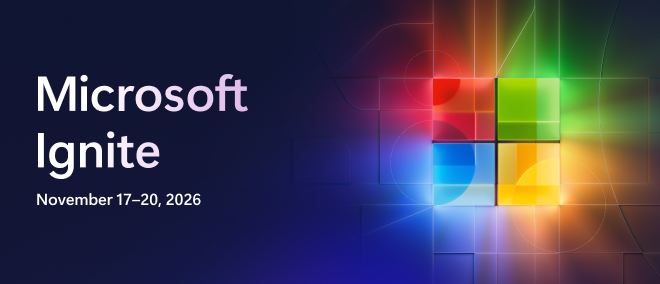

<a name="start-building"></a>

<p align="center">

</p>

# [Microsoft Ignite 2026](https://ignite.microsoft.com)

## 🔥LAB672: Ground agents in your business with an ontology in Fabric IQ
### Session description

Add your session description here. Keep it concise — 2-3 sentences about what attendees will learn and why it matters.

### 🚀 Getting started

#### In a guided session

If you're following along during a live session:

1. Open the [LAB672 attendee instructions](instructions/instructions.md).
2. Follow the facilitator through workspace setup and source staging.
3. Create and enrich your ontology, then investigate the supply-chain questions.

#### On your own

If you're learning at your own pace:

1. Open the [LAB672 attendee instructions](instructions/instructions.md).
2. Download the linked starter notebook and follow the workspace setup steps.
3. Work through all ten steps, checking the expected results before continuing.

### 🎯 Learning outcomes

By the end of this session, you will be able to:

- Create an ontology from a semantic model
- Enrich the ontology using the Ontology agent
- Expose ontology through various consumption experiences

### 💻 Technologies used

- **Microsoft Fabric IQ** — ontology and Ontology agent
- **Power BI semantic models** — starting point for ontology creation
- **Microsoft Fabric Lakehouse** — additional business entities and dependencies
- **Microsoft Fabric Eventhouse** — time-based operational observations
- **Microsoft Fabric notebooks** — lab setup and data staging

### 📚 Continue your learning

Pick your next step based on your learning style:

| Resource | What you'll get |
|----------|-----------------|
| **[Ignite 2026 Next Steps](https://aka.ms/ignite26-next-steps)** | Additional session repos and materials from Microsoft Ignite 2026 |
| **[Microsoft AI Skills Navigator](https://aka.ms/ignite26-asn)** | Discover AI skills, learning paths, and resources for your next step |
| **[Microsoft Learn](https://aka.ms/ignite26-learn)** | Official documentation and guided learning paths on these topics |
| **[Microsoft Foundry Community](https://aka.ms/MicrosoftFoundryDiscord-Ignite26)** | Connect with other learners and experts in our Discord community |

### 🌟 Microsoft Learn MCP Server

<!-- Remove this section if the Microsoft Learn MCP Server is not relevant to the session. -->

The Microsoft Learn MCP Server gives your AI agent direct access to Microsoft's official documentation — grounded, up-to-date answers about the topics in this session.

**GitHub Copilot CLI** — Install with:

```shell
copilot plugin install microsoftdocs/mcp
```

**VS Code** — One-click install:  
[](https://vscode.dev/redirect/mcp/install?name=microsoft-learn&config=%7B%22type%22%3A%22http%22%2C%22url%22%3A%22https%3A%2F%2Flearn.microsoft.com%2Fapi%2Fmcp%22%7D)

For more information, visit the [Learn MCP Server repo](https://aka.ms/learnmcp).

### 👥 Content owners

<!-- TODO: Add yourself as a content owner
1. Change the src in the image tag to {your github url}.png
2. Change INSERT NAME HERE to your name
3. Change the github url in the final href to your url. -->

<table>
<tr>
    <td align="center"><a href="http://github.com/yourGitHubHandle">
        <br />
        <sub><b>INSERT NAME HERE</b></sub></a><br />
            <a href="https://github.com/yourGitHubHandle" title="talk">📢</a>
    </td>
</tr></table>

### ⚖️ Trademarks

This project may contain trademarks or logos for projects, products, or services. Authorized use of Microsoft trademarks or logos is subject to and must follow [Microsoft's Trademark & Brand Guidelines](https://www.microsoft.com/legal/intellectualproperty/trademarks/usage/general). Use of Microsoft trademarks or logos in modified versions of this project must not cause confusion or imply Microsoft sponsorship.

Any use of third-party trademarks or logos are subject to those third-party's policies.
