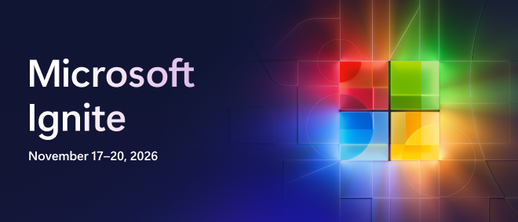

# [Microsoft Ignite 2026](https://ignite.microsoft.com)

## 🔥LAB672: Ground agents in your business with an ontology in Fabric IQ
### Session description

Ground agents in business data by creating a Fabric IQ ontology. Enrich the ontology, then explore supply-chain risks and delivery responses.

### 🚀 Getting started

#### In a guided session

If you're following along during a live session:

1. Open the [LAB672 attendee instructions](instructions/instructions-1.md).
2. Follow the facilitator through workspace setup and source staging.
3. Create and enrich your ontology, then investigate the supply-chain questions.

#### At your own pace

Use the supplied lab VM and the credentials in its **Resources** tab. This
walkthrough assumes access to that lab environment; it does not provision a VM
or Fabric capacity for you. Follow the same steps in order, checking each
**Expect** statement before continuing.

#### Walkthrough

1. [Create the lab workspace](instructions/instructions-1.md)
2. [Get the lab notebook](instructions/instructions-2.md)
3. [Stage the sources](instructions/instructions-3.md)
4. [Verify the data and semantic model](instructions/instructions-4.md)
5. [Create your ontology](instructions/instructions-5.md)
6. [Ask a business question](instructions/instructions-6.md)
7. [Enrich the ontology with dependencies](instructions/instructions-7.md)
8. [Enrich the ontology with observations](instructions/instructions-8.md)
9. [Add a business rule](instructions/instructions-9.md)
10. [Investigate deliveries and compare responses](instructions/instructions-10.md)

### 🎯 Learning outcomes

By the end of this session, you will be able to:

- Create an ontology from a semantic model
- Enrich the ontology using the Ontology agent and add business rules
- Investigate supply-chain risks and delivery responses using the Ontology agent

### 💻 Technologies used

- **[Microsoft Fabric IQ](https://learn.microsoft.com/fabric/iq/overview)** — ontology
  and Ontology agent
- **[Power BI semantic models](https://learn.microsoft.com/power-bi/connect-data/service-datasets-understand)**
  — starting point for ontology creation
- **[Microsoft Fabric Lakehouse](https://learn.microsoft.com/fabric/data-engineering/lakehouse-overview)**
  — additional business entities and dependencies
- **[Microsoft Fabric Eventhouse](https://learn.microsoft.com/fabric/real-time-intelligence/eventhouse)**
  — time-based operational observations
- **[Microsoft Fabric notebooks](https://learn.microsoft.com/fabric/data-engineering/how-to-use-notebook)**
  — lab setup and data staging

### 📚 Continue your learning

Pick your next step based on your learning style:

| Resource | What you'll get |
|----------|-----------------|
| **[Microsoft Ignite 2026](https://ignite.microsoft.com)** | Event information and access to Microsoft Ignite resources |
| **[Microsoft AI Skills Navigator](https://aka.ms/ignite26-asn)** | Discover AI skills, learning paths, and resources for your next step |
| **[Microsoft Learn](https://aka.ms/ignite26-learn)** | Official documentation and guided learning paths on these topics |

### 👥 Content owners

<table>
<tr>
    <td align="center">
        <a href="https://github.com/adamlash">
             
            <b>Adam Lash</b>
        </a>
    </td>
    <td align="center">
        <a href="https://github.com/falloutxAY">
             
            <b>Ansley Yeo</b>
        </a>
    </td>
    <td align="center">
        <a href="https://github.com/basakmutlum">
             
            <b>Basak Mutlum</b>
        </a>
    </td>
    <td align="center">
        <a href="https://github.com/YaelSchuster">
             
            <b>Yael Schuster-Davidi</b>
        </a>
    </td>
</tr></table>

### ⚖️ Trademarks

This project may contain trademarks or logos for projects, products, or services. Authorized use of Microsoft trademarks or logos is subject to and must follow [Microsoft's Trademark & Brand Guidelines](https://www.microsoft.com/legal/intellectualproperty/trademarks/usage/general). Use of Microsoft trademarks or logos in modified versions of this project must not cause confusion or imply Microsoft sponsorship.

Any use of third-party trademarks or logos are subject to those third-party's policies.
