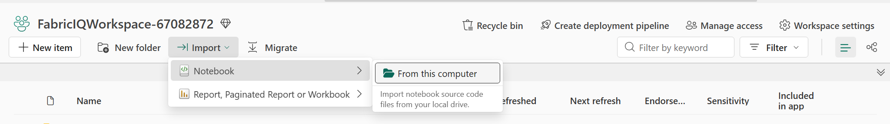

## Get the lab notebook

1. Look for `Stage_Zava_Workshop.ipynb` on the desktop of your VM. If it is not
   there, open the [LAB672 setup notebook](https://github.com/microsoft/ignite26-LAB672/blob/main/data/Stage_Zava_Workshop.ipynb)
   in the same browser you use for Fabric and select **Download raw file**.
   Note where the browser saves it, usually **Downloads**. Use the `.ipynb` file.
2. Open `FabricIQWorkspace` in the Fabric portal.
3. In the workspace toolbar, select **Import** > **Notebook** > **From this computer** >
   **Upload**.  
  
      

4. In the file picker that opens after you select **Upload**, select
   `Stage_Zava_Workshop.ipynb` and select **Open**. Wait for the import to finish.

5. In the workspace item list, select the imported notebook to open it. For details, see
   [Microsoft Learn notebook import guidance](https://learn.microsoft.com/fabric/data-engineering/how-to-use-notebook#import-existing-notebooks).
6. Do not attach a Lakehouse to the notebook.
