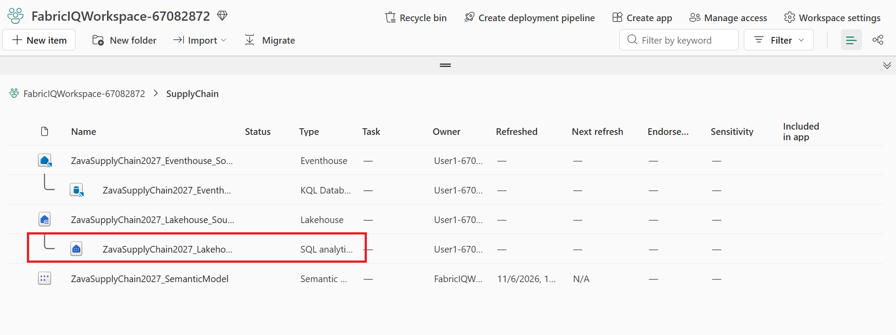
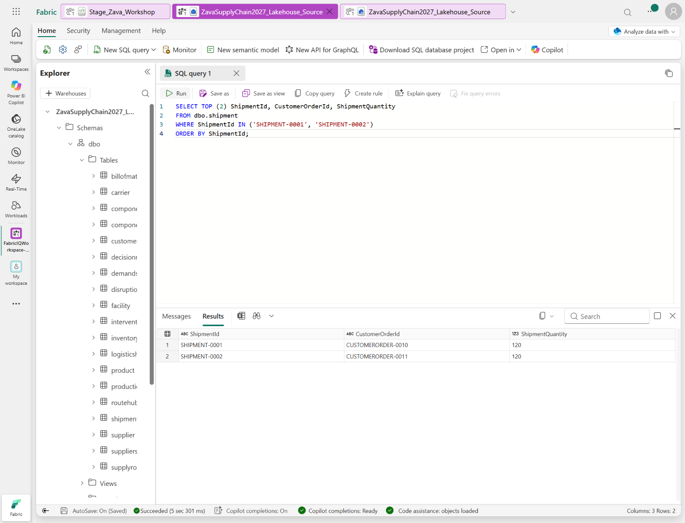
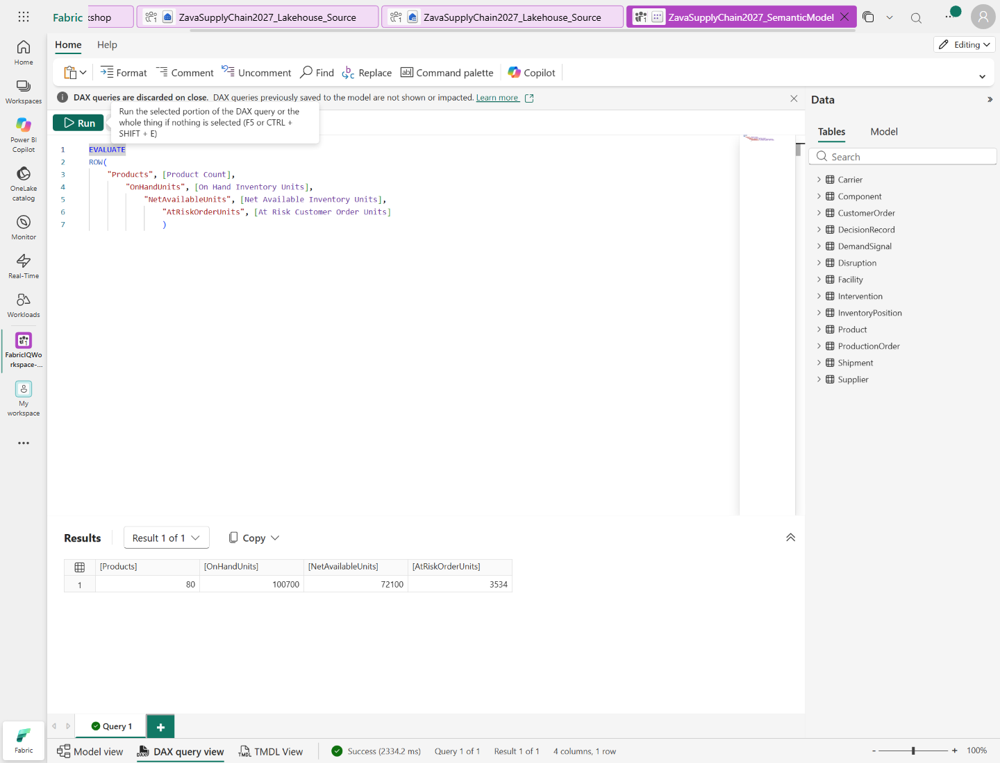

## Verify the data and semantic model

[Previous: Stage the sources](instructions-3.md) | [Contents](../README.md#walkthrough) | [Next: Create your ontology](instructions-5.md)

1. In the workspace's **SupplyChain** folder, select
   **ZavaSupplyChain2027_Lakehouse_Source** with type **SQL analytics endpoint**,
   not the item with type **Lakehouse**. Both items have the same name.

   

   The SQL query editor opens. For details, see [Microsoft Learn guidance
   for accessing a Lakehouse SQL analytics endpoint](https://learn.microsoft.com/fabric/data-engineering/lakehouse-sql-analytics-endpoint).
   If this entry stays on the loading screen, open the **Lakehouse** item instead
   and select **Analyze data with** > **SQL analytics endpoint**. If necessary,
   refresh the browser page once after the endpoint opens.
2. In the explorer pane, expand **Schemas** > **dbo** > **Tables** and ensure that the 19 lowercase tables are there.
3. Select **New SQL query**.
4. Paste this query into the editor and select **Run**:

   ```sql
   SELECT TOP (2) ShipmentId, CustomerOrderId, ShipmentQuantity
   FROM dbo.shipment
   WHERE ShipmentId IN ('SHIPMENT-0001', 'SHIPMENT-0002')
   ORDER BY ShipmentId;
   ```

   **Expect:** both shipments appear, each with a quantity of **120**.

   

5. Return to the **SupplyChain** folder in `FabricIQWorkspace`.
6. Select the semantic model's **...** menu, then select
   **Open in DAX query view**. Close the introductory dialog if it appears.
   Select all text in the DAX editor and replace the sample query with the query
   below, then select **Run**. Do not select **Update model with changes**; this
   step only queries the existing measures.
   For details, see [Microsoft Learn guidance for DAX query view](https://learn.microsoft.com/power-bi/transform-model/dax-query-view).

   ```dax
   EVALUATE
   ROW(
       "Products", [Product Count],
       "OnHandUnits", [On Hand Inventory Units],
       "NetAvailableUnits", [Net Available Inventory Units],
       "AtRiskOrderUnits", [At Risk Customer Order Units]
   )
   ```

   **Expect:** 80, 100700, 72100, and 3534.

   

7. Return to the **SupplyChain** folder in `FabricIQWorkspace`.
