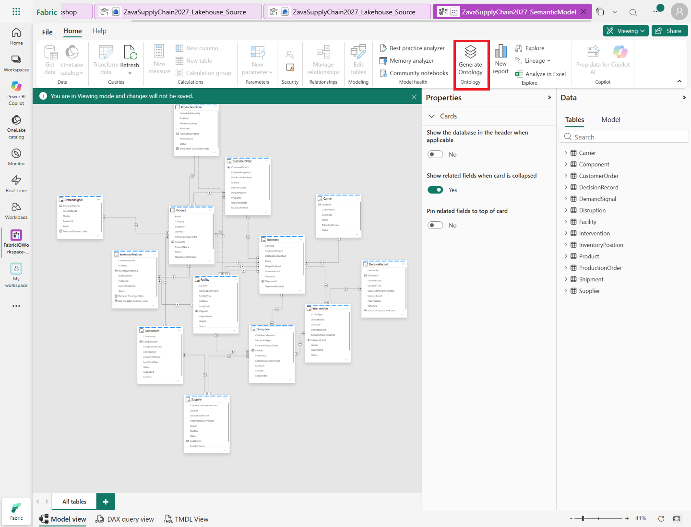
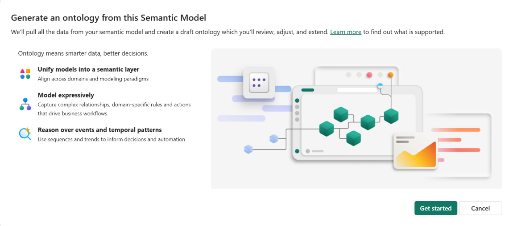
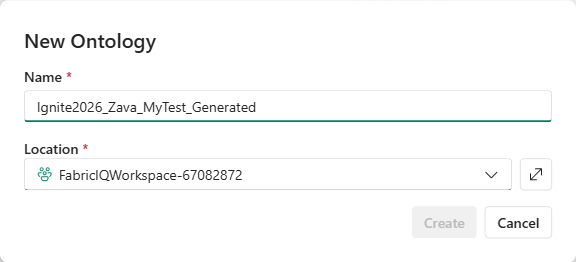
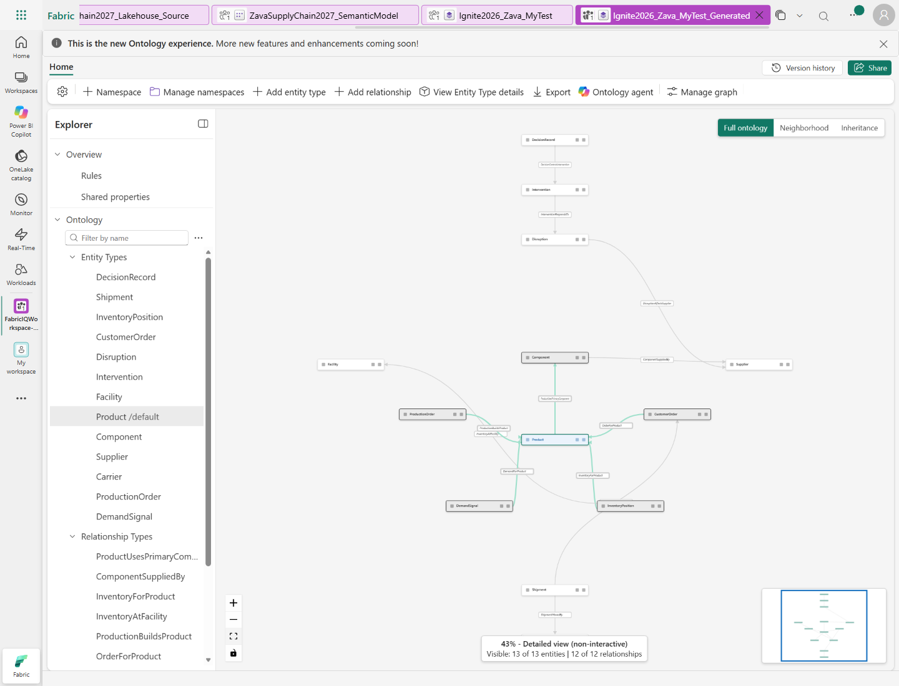
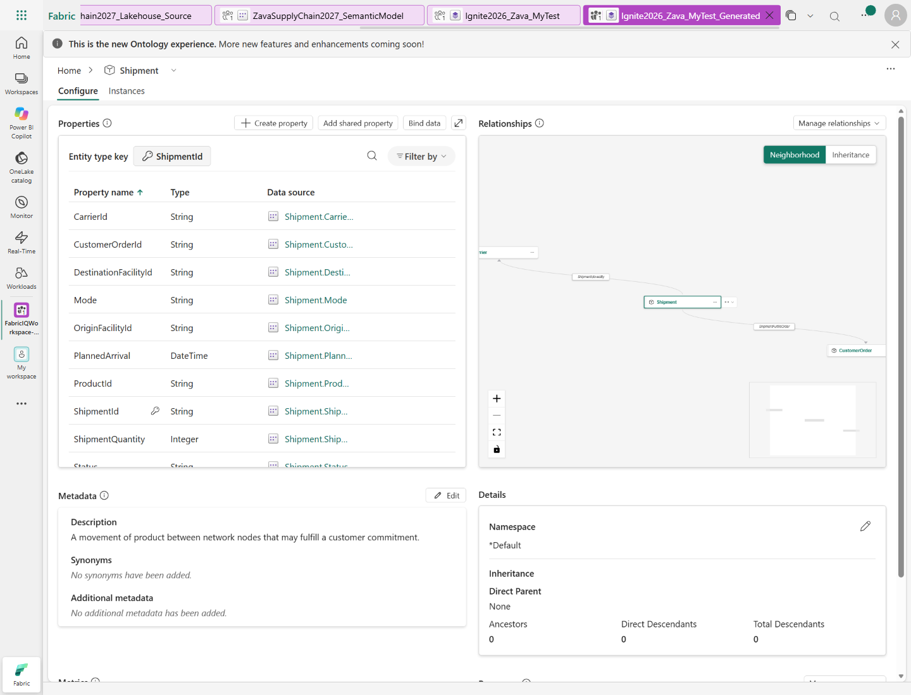

## Create your ontology

1. In the workspace's **SupplyChain** folder, open
   **ZavaSupplyChain2027_SemanticModel**.
2. In the semantic model toolbar, select **Generate Ontology**. For details, see
   [Microsoft Learn guidance for generating an ontology from a semantic model](https://learn.microsoft.com/fabric/iq/ontology/how-to-generate-from-semantic-models#create-the-ontology-item).

   

3. Wait for **Generate an ontology from this Semantic Model** to open, then select
   **Get started**. The first launch can take time; do not repeatedly select
   **Generate Ontology** while it loads.

   

4. In **New Ontology**, select the workspace root as the location, enter
   `Ignite2026_Zava_MyTest` as the ontology name, and select **Create**. If that
   name already exists, use a unique suffix. The screenshots use
   `Ignite2026_Zava_MyTest_Generated`.
   If a welcome dialog opens in the new ontology, select **Get started**.
   If you need to reopen the item, find it at the workspace root, outside
   **SupplyChain**.

   

   

5. On the ontology Home canvas, select an entity type in the **Explorer**, then select
   **View Entity Type details** on the top ribbon. In the **Configure** tab, review its
   properties, key, data bindings, and **Metrics**. Repeat for Shipment,
   InventoryPosition, CustomerOrder, Disruption, Intervention, and DecisionRecord.
   The metrics should still name **ZavaSupplyChain2027_SemanticModel** as their
   source.

   

7. Open **Instances** for Shipment and confirm that rows appear, including
   relationship to inspect it. Do not change the relationship in this step.
9. Open **Ontology agent** from the toolbar and select **Plan** mode with t  
he toggle
   below the chat box. Ask it to explain the metrics available for these entity types.
   Compare its answer with the starting semantic model; don't change the model.

**Expect:** the ontology has concepts corresponding to the model's 13 business tables.
The starter doesn't include a prebuilt reference ontology.
