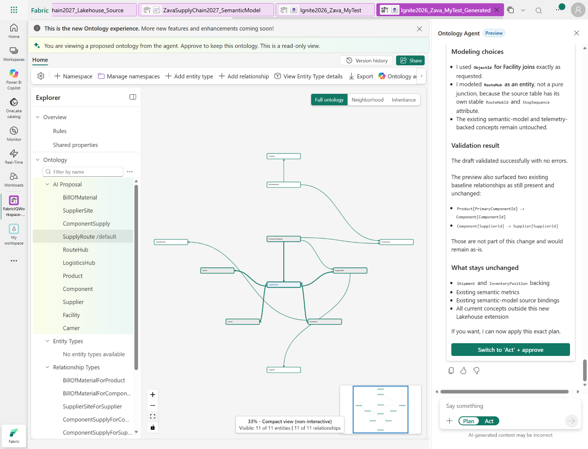
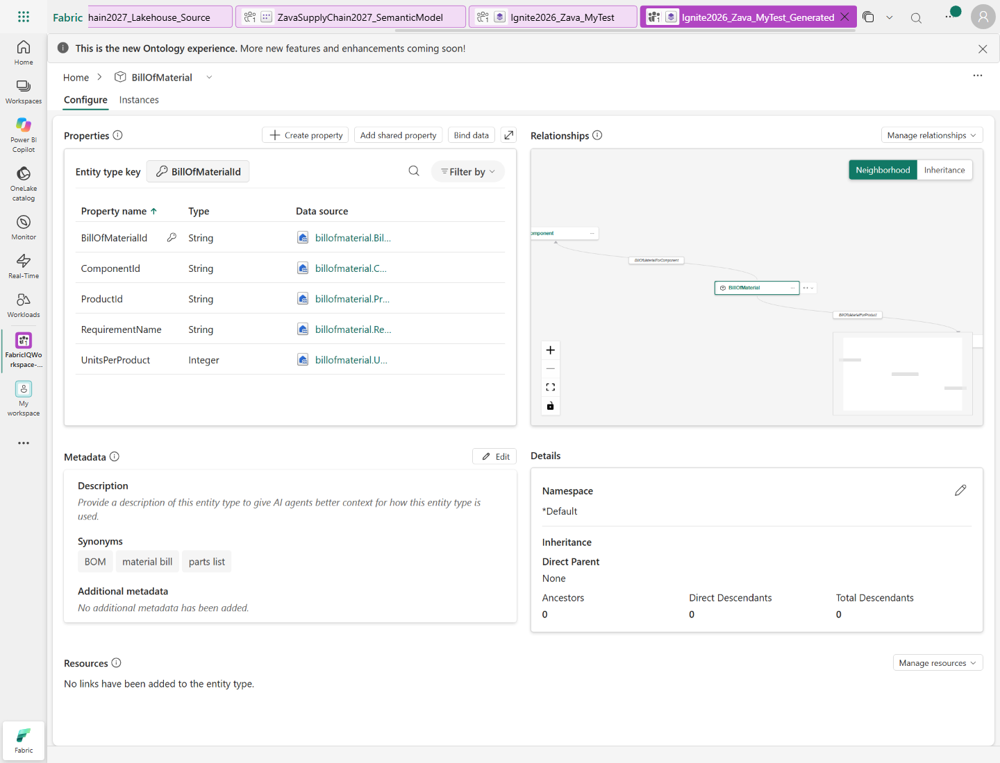
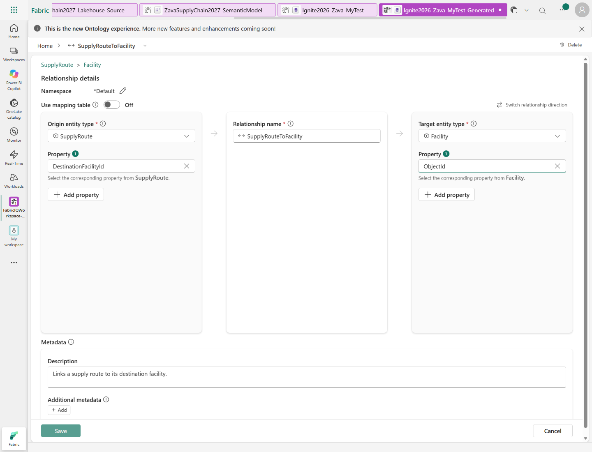
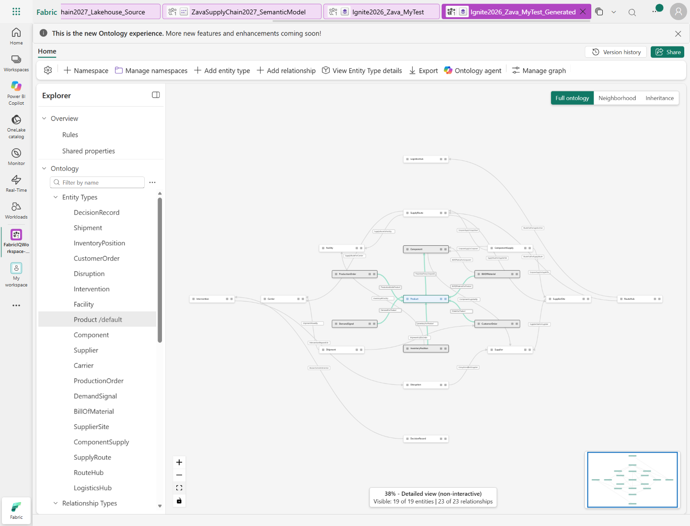
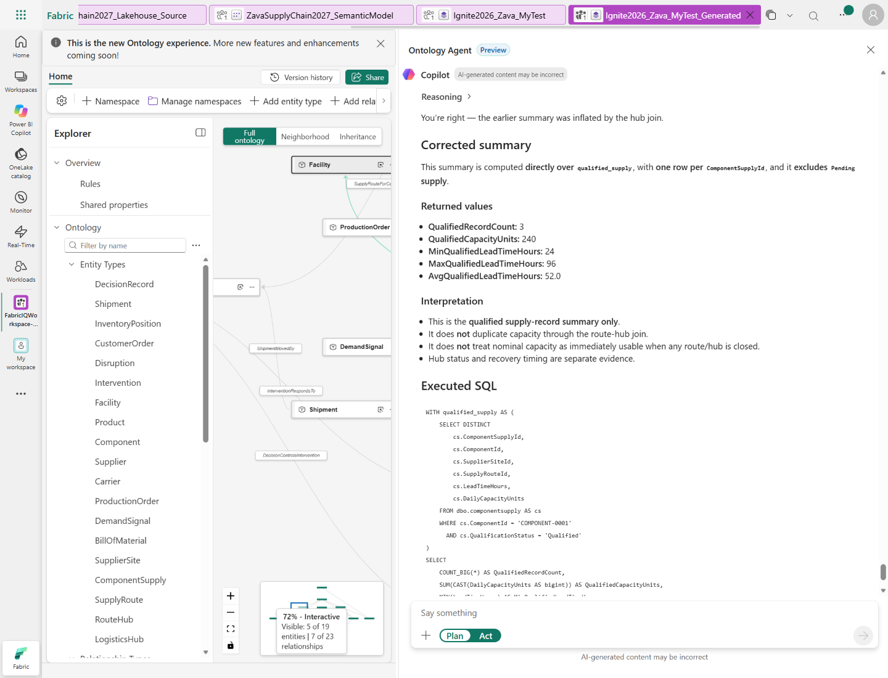

## Enrich the ontology with dependencies

1. In the Ontology agent chat, use the toggle below the chat box to select **Plan** mode.
2. Ask the agent to propose the changes without applying them:

   `Find the supply-chain dependencies in our Zava lakehouse that aren't in this ontology yet. Propose adding BillOfMaterial, SupplierSite, ComponentSupply, SupplyRoute, RouteHub, and LogisticsHub using the Lakehouse, and connect them to the existing ontology. Reuse Product, Component, Supplier, Facility, and Carrier. Use ObjectId for Facility joins. Keep the existing Shipment and InventoryPosition backing, semantic metrics, and model unchanged. Show the plan first; don't apply it yet.`

3. When the agent posts a draft preview, select it. Review the proposed entity types,
   properties, data bindings, and relationships. Confirm the proposal reuses Product, Component,
   Supplier, Facility, and Carrier; Facility joins use **ObjectId**. Preserve existing
   Shipment and InventoryPosition backing, semantic metrics, and the model.

   

4. After reviewing the proposal, switch to **Act** mode with the toggle below the chat
   box and send:

   `Apply only the plan we just reviewed. Keep everything else unchanged.`

5. After the agent finishes, return to **Plan** mode. On the Home canvas, use the
   **Explorer** and **View Entity Type details** to verify the applied entity bindings
   and keys. Return to **Home** and select the new relationships under
   **Relationship Types** in the Explorer, then select **View Relationship Type
   details** on the ribbon. Confirm the endpoints and property bindings match
   the reviewed proposal. There is no separate Relationship tab.

   

   If a relationship shows **Select a property** on either side, the relationship
   exists but its join is not configured. Select the corresponding **Property 1**
   on each side and select **Save**. Check these joins; the agent's relationship
   names may vary, so identify each by its entity endpoints:

   | Origin entity | Origin property | Target entity | Target property |
   |---|---|---|---|
   | BillOfMaterial | ProductId | Product | ProductId |
   | BillOfMaterial | ComponentId | Component | ComponentId |
   | SupplierSite | SupplierId | Supplier | SupplierId |
   | ComponentSupply | ComponentId | Component | ComponentId |
   | ComponentSupply | SupplierSiteId | SupplierSite | SupplierSiteId |
   | ComponentSupply | SupplyRouteId | SupplyRoute | SupplyRouteId |
   | SupplyRoute | SupplierSiteId | SupplierSite | SupplierSiteId |
   | SupplyRoute | DestinationFacilityId | Facility | ObjectId |
   | SupplyRoute | CarrierId | Carrier | CarrierId |
   | RouteHub | SupplyRouteId | SupplyRoute | SupplyRouteId |
   | RouteHub | LogisticsHubId | LogisticsHub | LogisticsHubId |

   If a relationship is displayed in the opposite direction, match each property
   to its entity rather than swapping the values blindly.
   Reopen the relationship after saving and confirm that the choices persist.
   Use **Select relationship type** beside the relationship name to inspect the
   next relationship.

   

   

6. Ask:

   `Where is our supply chain most vulnerable?`

7. Ask:

   `Why is that a risk? Show me what depends on it.`

8. Ask:

   `Do we have a genuine alternative?`

9. Ask:

   `Which customer orders could be affected?`

10. Ask the agent to show the query and source tables behind its answer. Read the
    generated query in the response and confirm that the traversal includes
    primary-component links and bills of material. Ask it to state any timing
    assumptions.
    If the answer only lists orders whose status is **AtRisk**, or only follows
    each product's primary component, ask:

    `Show the actual query and source tables behind your dependency-exposure answer. Re-derive customer-order exposure by traversing both Product.PrimaryComponentId and BillOfMaterial to ComponentSupply, SupplierSite, SupplyRoute, RouteHub, and LogisticsHub. Do not substitute CustomerOrder.Status=AtRisk or a truncated sample for that traversal. Discover LogisticsHub.SnapshotTime, state timing assumptions, and deduplicate by CustomerOrderId. Show total matched versus returned rows.`

    A list of 20 returned orders is not proof that there are only 20 matching
    orders. Check whether the query is limited or the response is a sample.
11. Ask:

    `For the alternative you identified, show the available qualified supply capacity,
    lead time, and shared dependencies. Include the source tables and query you used.`

12. Check the returned supply and dependency evidence against the entities and
    relationships in the ontology.
    In particular, check that the agent:

    - Filters **QualificationStatus = Qualified** before counting usable candidates.
    - Aggregates capacity at one row per **ComponentSupplyId**, before joining to
      RouteHub. A route with two hubs must not count the same supply capacity twice.
    - Names shared hub IDs and checks their **Status** and **ExpectedRecoveryHours**
      at the observed **SnapshotTime**.
    - Treats missing supply-path records as missing evidence, not proof of a disruption.

    For `COMPONENT-0001` in the supplied lab data, there are three qualified supply
    records with **240 units/day of nominal capacity** and lead times of
    **24, 36, and 96 hours**. `SUPPLY-0003` is **Pending**; its 300 units/day must
    not enter that total. The first two qualified paths share **HUB-0001**, which
    is **Closed** with 72 hours expected recovery at the latest supplied snapshot.
    Nominal qualified capacity is not proof of immediately available capacity or
    an on-time delivery alternative.

    If the agent sums capacity after the hub join, ask:

    `Run the capacity and lead-time summary directly over qualified supply, with one row per ComponentSupplyId, independently from the hub-detail query. Show the executed summary SQL and returned values. Do not count Pending capacity or describe nominal capacity as immediately usable while its route has a Closed hub.`

    

**Expect:** the answer follows multiple hops through new and existing entities, checks
qualification and lead time, and deduplicates orders. It describes dependency exposure,
not predicted lost sales or proof of the cause of earlier delays. 
