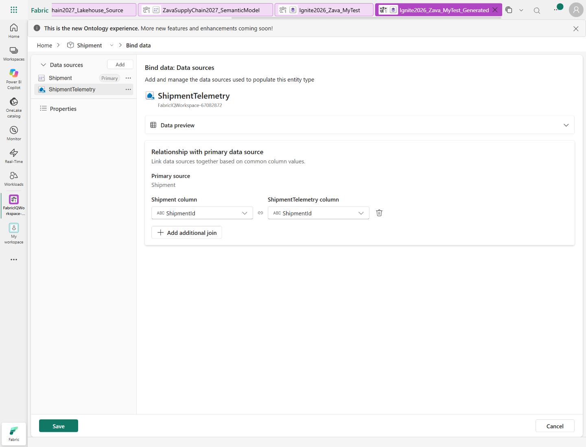
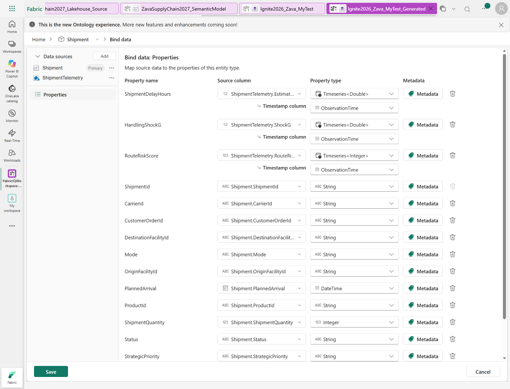
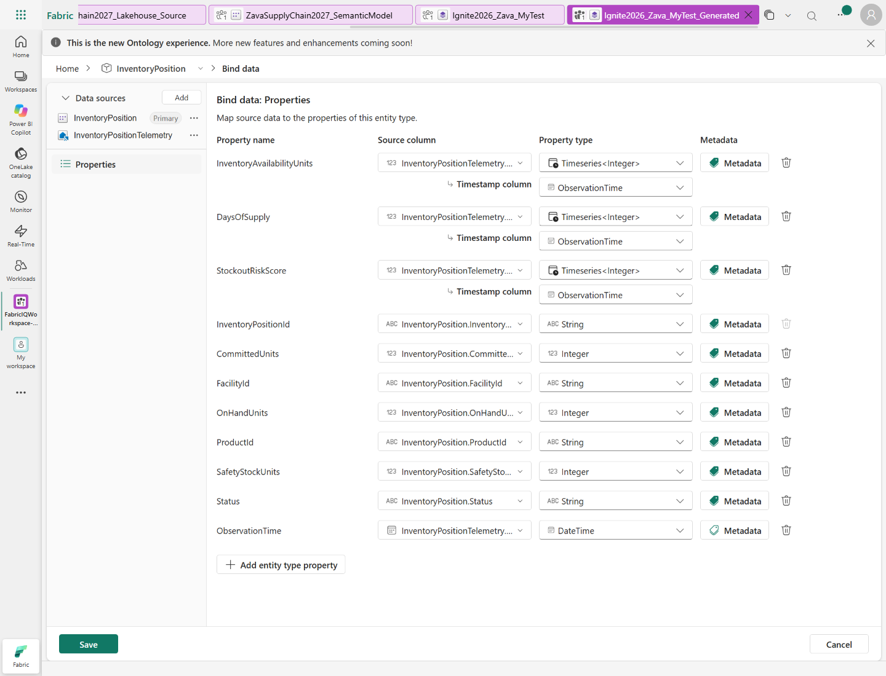

## Enrich the ontology with observations

[Previous: Enrich the ontology with dependencies](instructions-7.md) | [Contents](../README.md#walkthrough) | [Next: Add a business rule](instructions-9.md)

1. In the Ontology agent chat, use the toggle below the chat box to select **Plan** mode.
2. Ask the agent to propose the observation properties without applying them:

    `Add shipment delay, handling shock, and route risk, plus inventory availability, days of supply, and stockout risk, from the Zava source Eventhouse. Match the existing objects and use observation time. Keep existing concepts and semantic-model grounding unchanged. Show the plan first; don't apply it yet.`

3. Review the proposal against these source mappings:

   | Existing concept | Source table | Matching key | Time column |
   |---|---|---|---|
   | Shipment | ShipmentTelemetry | ShipmentId | ObservationTime |
   | InventoryPosition | InventoryPositionTelemetry | InventoryPositionId | ObservationTime |

   Confirm that the proposal adds six observation properties without replacing
   existing concepts or losing their semantic-model grounding.

4. After reviewing the proposal, use the toggle below the chat box to switch to
   **Act** mode. In the chat, send:

   `Apply only the plan we just reviewed. Keep everything else unchanged.`

5. After the agent finishes, switch back to **Plan** mode. Return to the ontology Home
   canvas. In the **Explorer**, select Shipment, then
   select **View Entity Type details** on the top ribbon. In the **Configure** tab,
   confirm that the three shipment observation properties and their bindings to
   **ShipmentTelemetry** are present. Repeat for InventoryPosition and confirm its
   three properties are bound to **InventoryPositionTelemetry**.
6. To inspect the joins, select a telemetry link in the **Data source** column,
   for example **ShipmentTelemetry.ShockG**. In **Bind data**, confirm that
   **Shipment** remains the primary source and both join columns are
   **ShipmentId**. For InventoryPosition, both join columns must be
   **InventoryPositionId**.

   

7. In the binding editor's left pane, select **Properties**. Confirm that each
   observation value has a **Timeseries** type and its **Timestamp column** is
   **ObservationTime**, not a business date such as PlannedArrival.
   Select **Cancel** to leave this inspection without changing the bindings.

   

   

8. Open **Instances** for both entity types and confirm that primary source rows
   still appear. The instance list alone is not proof that telemetry was queried;
   the delivery investigation later in the lab checks the actual telemetry queries.
