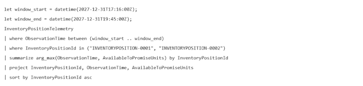
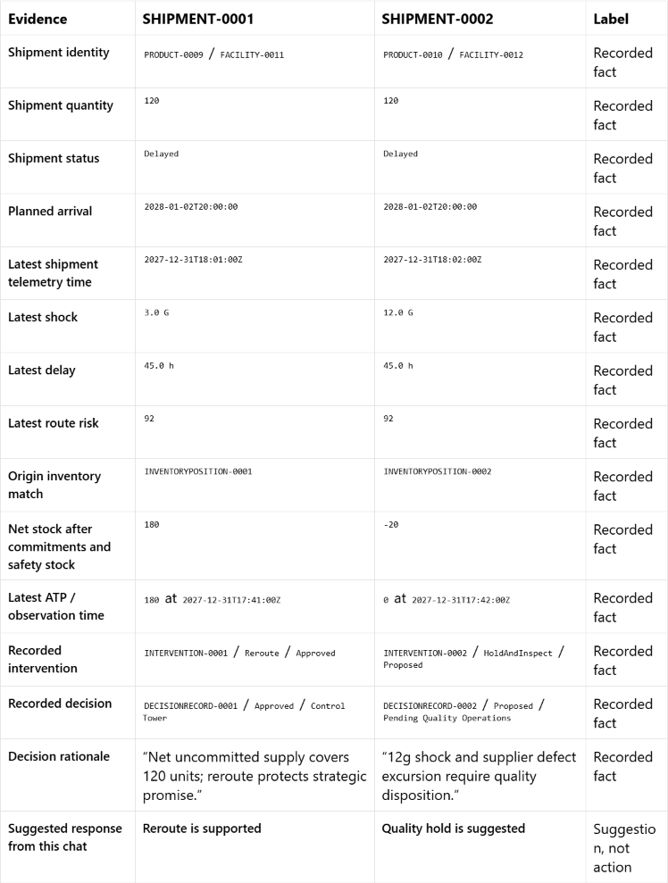

## Investigate deliveries and compare responses

1. In the Ontology agent chat, use the toggle below the chat box to select **Plan** mode.
   Then ask:

   `Which deliveries need our attention?`

2. Ask:

   `What makes these stand out?`

3. Ask:

   `Should we respond to all of them the same way?`

4. Ask:

   `What have we already decided, and what still needs checking?`

5. Ask:

   `Show me the data behind that.`

6. Ask:

   `Show the actual queries, sources, and observation times behind that answer.
   Separate recorded facts from your interpretation.`

   Read the query shown with the answer. Identify its source table and time column,
   and compare the observation times with the available window the agent discovered.
   If the answer doesn't show a query, ask the agent to display it.

7. Use the dates discovered in the data. Don't substitute today's date. If the answer
   doesn't state the available time range, ask the agent to show the earliest and
   latest observation times before continuing.
   Check that the time filter appears **before** `arg_max` in each telemetry
   query. A latest-per-identity query over the whole table is not a bounded
   analysis window. For a common window, use a start no earlier than the later
   of the two earliest observation times, and an end no later than the earlier
   of the two latest observation times.

   If the answer still lacks shipment-specific stock evidence or refers only to
   suggestions made in the chat, ask:

   `For stock support, match each shipment ProductId plus OriginFacilityId to InventoryPosition.ProductId plus FacilityId, not destination facility. Query those source rows and corresponding InventoryPositionTelemetry IDs. Use a common bounded window whose start is no earlier than the later of the two earliest observed telemetry times, and filter before arg_max. Compare OnHandUnits - CommittedUnits - SafetyStockUnits and latest AvailableToPromiseUnits with each ShipmentQuantity. Keep the approved reroute distinct from the proposed quality hold; no action execution or invented thresholds. Show the actual evidence queries.`

   

8. Ask the agent to show a compact side-by-side evidence matrix for
   `SHIPMENT-0001` and `SHIPMENT-0002`, including the common telemetry window,
   origin inventory match, net stock after commitments and safety stock,
   latest available-to-promise units and observation time, shipment quantity,
   intervention status, and recorded decision status.

   

   In the supplied data, both shipments have a quantity of **120**.
   Shipment 0001's matched origin inventory has **180** net units after
   commitments and safety stock, and latest ATP of **180**. Shipment 0002's
   matched origin inventory has **-20** net units and latest ATP of **0**.
   These support different discussions; they are not evidence that either
   response was executed. A score or response tier invented by the agent is
   interpretation, not an established business policy.

**Expect:** the agent discovers the available time range, selects a bounded window
within the data, and shows the latest observations per identity in that window. The
answer distinguishes stock-supported reroute discussion from a proposed quality hold.
It doesn't claim that either action was executed or that on-time delivery was proved.
Shock values are observations, not documented policy thresholds. The example evidence
window in the source data is **17:00-20:00 UTC on 31 December 2027**. A correct-looking
answer without actual source queries isn't a full pass.
